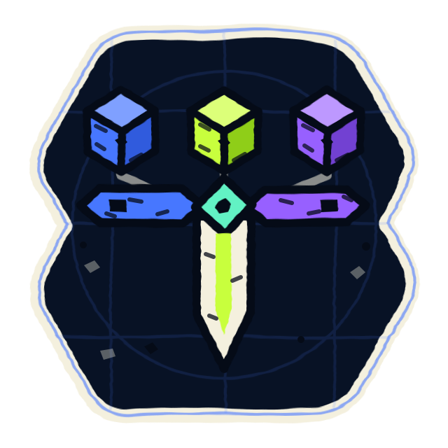

<p align="center">
  
</p>

<h1 align="center">dagger</h1>

<p align="center">
  Reusable Dagger modules.
</p>

## Modules

Each module is a [Dang](https://docs.dagger.io/reference/sdks/dang) module for
Dagger 1.0, released together under one `v<version>` tag.

| Module                               | Purpose                                                       |
| ------------------------------------ | ------------------------------------------------------------- |
| [actionlint](./actionlint/readme.md) | Lint GitHub Actions workflows and their shell scripts         |
| [beachball](./beachball/readme.md)   | Check and generate Beachball change files                     |
| [cargo](./cargo/readme.md)           | Format, lint and test Cargo workspaces; update lock files     |
| [changesets](./changesets/readme.md) | Check and generate Changesets change files                    |
| [ci](./ci/readme.md)                 | Generate workspace metadata, apply fixes and update snapshots |
| [next](./next/readme.md)             | Build Next.js apps and standalone runtime images              |
| [nginx](./nginx/readme.md)           | Build nginx images and check configuration and responses      |
| [projen](./projen/readme.md)         | Synthesize projen projects and refresh lock files             |
| [supabase](./supabase/readme.md)     | Push migrations and deploy Edge Functions                     |
| [terraform](./terraform/readme.md)   | Check Terraform roots and update provider lock files          |
| [typescript](./typescript/readme.md) | Type-check pnpm workspaces and validate release builds        |
| [vitest](./vitest/readme.md)         | Run workspace Vitest suites                                   |
| [zig](./zig/readme.md)               | Build and test Zig projects                                   |

## Python

Python tooling comes from upstream rather than from here:
[`github.com/dagger/python/ruff`](https://github.com/dagger/python/tree/main/ruff)
for linting and formatting, and
[`github.com/dagger/python/ty`](https://github.com/dagger/python/tree/main/ty)
for type-checking. Their tags are `v<version>` at the repository root.

[`github.com/dagger/python/uv`](https://github.com/dagger/python/tree/main/uv)
keeps `uv.lock` current: its `lock` generator runs `uv lock`, and its stale
check fails on a lock file that `uv lock --check` would reject. It locks only
projects that already have a `uv.lock`, with the uv its image ships rather than
the project's. It also audits the locked dependencies as a check. Generators all
read the same tree, so when projen changes `pyproject.toml`, `uv.lock` follows
on the next `dagger generate`.

## Legacy

The previous TypeScript modules — `hermes`, `hermes-workspace`, `letta-code`,
`paperclip`, `tailscale` and `tigerfs` — are on the
[`legacy`](https://github.com/langri-sha/dagger/tree/legacy) branch.

## Working on the repository

Projen manages the repository root and writes each module's `dagger-module.toml`
from the `dagger` option in `.projenrc.ts`, which also pins the engine version
for all of them.

```sh
pnpm install
pnpm projen   # re-synthesize root config after editing .projenrc.ts
pnpm format   # prettier --write .
```
